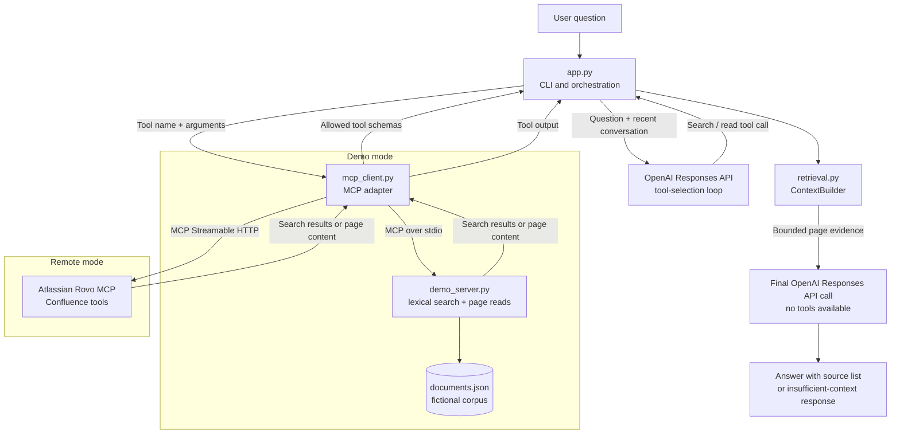

# Confluence MCP Chatbot

A command-line knowledge assistant that searches engineering documentation
through the [Model Context Protocol (MCP)](https://modelcontextprotocol.io/) and
uses the OpenAI Responses API to produce concise, source-linked answers.

The project demonstrates a bounded retrieval-augmented generation (RAG) flow:
the model selects read-only search and page-retrieval tools, the application
collects and limits the retrieved evidence, and a separate model call answers
from that evidence. A local MCP server makes the demo and retrieval evaluation
usable without a Confluence tenant. Only interactive chatbot answers require
an OpenAI API key.

> **Demo data:** The included documentation is fictional and intended for
> demonstrating the retrieval flow. It contains no production Confluence
> content, credentials, or organization-specific URLs.

## What it demonstrates

- **MCP tool calling:** Connects the OpenAI tool loop to a local stdio server or
  a remote MCP server over Streamable HTTP.
- **Inspectable retrieval:** The demo server uses deterministic lexical
  ranking, so search results are reproducible and easy to debug.
- **Bounded evidence:** Limits tool calls, page retrieval, and the amount of
  tool output and page content sent to the model.
- **Grounded answer generation:** Makes the final answer in a separate
  no-tools call with retrieved documentation and instructions to cite sources
  or report insufficient evidence.
- **Repeatable evaluation:** Tests retrieval against a fixed question set
  without making OpenAI API calls.
- **Automated checks:** GitHub Actions runs the tests and retrieval evaluation
  on pushes, pull requests, and manual dispatches.

## Architecture

The MCP connection is interchangeable: the local demo server and a remote
Atlassian server expose tools through the same client adapter.



### Request lifecycle

1. **Connect and discover tools.** `MCPConnection` opens the configured MCP
   transport, lists available tools, and filters them before exposing their
   schemas to the model.
2. **Search.** The app sends the question and a short conversation history to
   the OpenAI Responses API with the allowed tools. The model decides whether
   and how to search. In demo mode, `search_pages` ranks documents by lexical
   overlap: title matches weigh more than tags, and tags weigh more than body
   matches; phrase matches receive an additional score.
3. **Read relevant pages.** The model can call a page-read tool for results
   worth inspecting. Each tool response is returned to the model, which may
   request another search or page read within the configured limits.
4. **Build evidence.** `ContextBuilder` extracts page-like records from MCP
   responses, deduplicates pages by ID, and retains up to the page limit. It
   bounds the cumulative tool output sent through the tool loop and separately
   bounds the assembled page context.
5. **Answer.** The app makes a final Responses API call with no tools available,
   supplying the question and collected page evidence. The model is instructed
   to answer only from that evidence, include source titles and URLs, and state
   when the documentation does not support an answer.
6. **Keep short-lived context.** The CLI retains up to three prior
   user/assistant exchanges in memory for follow-up questions. It does not
   persist chat history between runs.

## RAG design

This is **tool-driven retrieval**, not embedding-based semantic search. In demo
mode, the search server tokenizes text, removes a small set of stop words, and
applies a lightweight suffix normalizer. It scores matches in document titles,
tags, and content, then returns a ranked list with short snippets. The model
uses those results to select pages; the full pages—not just the snippets—are
provided to the final answer call.

The application applies independent limits to keep a request bounded:

| Limit | Default | Configuration |
|---|---:|---|
| Tool-call rounds | 4 | `MAX_TOOL_ROUNDS` |
| Total MCP tool calls | 8 | `MAX_TOOL_CALLS` |
| Retrieved pages | 5 | `MAX_PAGES` |
| Tool-output / assembled-context characters | 24,000 | `MAX_CONTEXT_CHARS` |

These are application-level limits, not guarantees about model behavior. The
final answer is prompted to use only retrieved documentation, but the project
does not independently verify every factual claim or enforce that every answer
contains a valid citation.

## Requirements

- Python 3.11 or newer (the project has been tested with Python 3.13)
- An OpenAI API key to run the interactive chatbot
- No OpenAI API key or Confluence account is needed for the local retrieval
  evaluation and automated tests

## Setup

### Windows PowerShell

```powershell
python -m venv .venv
.\.venv\Scripts\Activate.ps1
python -m pip install -r requirements.txt
Copy-Item .env.example .env
```

### macOS or Linux

```bash
python3 -m venv .venv
source .venv/bin/activate
python -m pip install -r requirements.txt
cp .env.example .env
```

For interactive answers, set `OPENAI_API_KEY` in `.env`. The default model is
`gpt-6-luna`; set `OPENAI_MODEL` to a model available to your OpenAI project
that supports function calling in the Responses API. Keep `.env` local—Git
ignores it.

## Run the chatbot

Demo mode is the default. The client starts `demo_server.py` as an MCP stdio
subprocess; the chatbot itself accesses the fictional corpus through MCP tools.

```powershell
python app.py
```

Example questions:

```text
How does our CI pipeline report failed tests?
How long are those artifacts retained?
What happens when a deployment breaches an SLO?
What is our cafeteria menu?
```

The last question has no supporting page in the sample corpus and should result
in an insufficient-documentation answer. After each response, the CLI reports
elapsed time, MCP call count, and number of full pages collected. Latency varies
by network and model; the displayed time is a per-request measurement, not a
benchmark.

## Tests and retrieval evaluation

Run the automated tests and deterministic retrieval evaluation:

```powershell
python -m pytest -q
python eval.py
```

`eval.py` sends 30 predefined questions through the actual local MCP server.
It reports Hit@3 and Recall@3 against expected page IDs, mean and p95 search
latency, a source-attribution helper check, and an insufficient-context check.
It makes no OpenAI calls. The attribution and insufficient-context checks are
small helper checks; they do not evaluate whether generated chatbot answers
are factually correct.

GitHub Actions runs both the test suite and `eval.py` on pushes, pull requests,
and manual dispatches. These checks do not require secrets or an OpenAI API key.

## Connect to a remote Confluence MCP server

Set `MCP_MODE=remote` and configure the MCP endpoint and authorization header in
`.env`:

```dotenv
MCP_MODE=remote
MCP_REMOTE_URL=https://mcp.atlassian.com/v2/mcp
MCP_AUTH_HEADER=Bearer <access-token>
MCP_ALLOWED_TOOLS=searchConfluence,getConfluenceContent,discover,executeRead
```

The code forwards the configured authorization header; it does not implement
OAuth login, token acquisition, or token refresh. Obtain credentials through
your organization-approved flow or credential manager, and do not commit them.
Atlassian access requires the relevant organization configuration and
permissions. Prefer read/search scopes only.

By default, the client allows tools whose names begin with `search`, `get`,
`list`, `discover`, or `executeRead` (case-insensitive, with underscores
ignored). If `MCP_ALLOWED_TOOLS` is set, that explicit list replaces the
name-based filter. This is a client-side exposure filter, not an authorization
boundary; server-side permissions must also restrict access.

Tool names and response shapes vary by Atlassian tenant and server version. The
generic remote transport is implemented, but a live Atlassian tenant is not
covered by the local tests. See the official
[Rovo MCP getting-started guide](https://developer.atlassian.com/cloud/rovo-mcp/guides/getting-started/),
[supported tools](https://developer.atlassian.com/cloud/rovo-mcp/guides/supported-tools/),
and [API-token authentication guide](https://developer.atlassian.com/cloud/rovo-mcp/guides/configuring-authentication-via-api-token/)
for current setup details.

## Project structure

| File | Responsibility |
|---|---|
| `app.py` | CLI, short-lived chat history, bounded OpenAI tool loop, and final answer generation |
| `mcp_client.py` | Shared MCP adapter for local stdio and remote Streamable HTTP |
| `demo_server.py` | Local MCP tools and deterministic lexical document search |
| `retrieval.py` | Page extraction, deduplication, evidence budgets, and evaluation helpers |
| `documents.json` | Fictional engineering documentation used by demo mode |
| `eval.py` | Deterministic retrieval metrics through the local MCP server |
| `eval_questions.json` | 30 evaluation questions and expected page IDs |
| `tests/` | Tests for the app tool flow, MCP client, retrieval, and search |
| `.github/workflows/ci.yml` | GitHub Actions test and retrieval-evaluation workflow |

## Design boundaries

- The local search implementation is deliberately transparent and deterministic;
  it is not intended to represent production-grade semantic retrieval.
- There is no embedding index, vector database, reranker, persistent chat
  history, or web interface.
- The final answer is prompted to be source-grounded, but citation presence and
  factual entailment are not enforced by a separate validator.
- Real Confluence tool availability, permissions, and result formats depend on
  the Atlassian tenant and should be validated before relying on remote mode.
